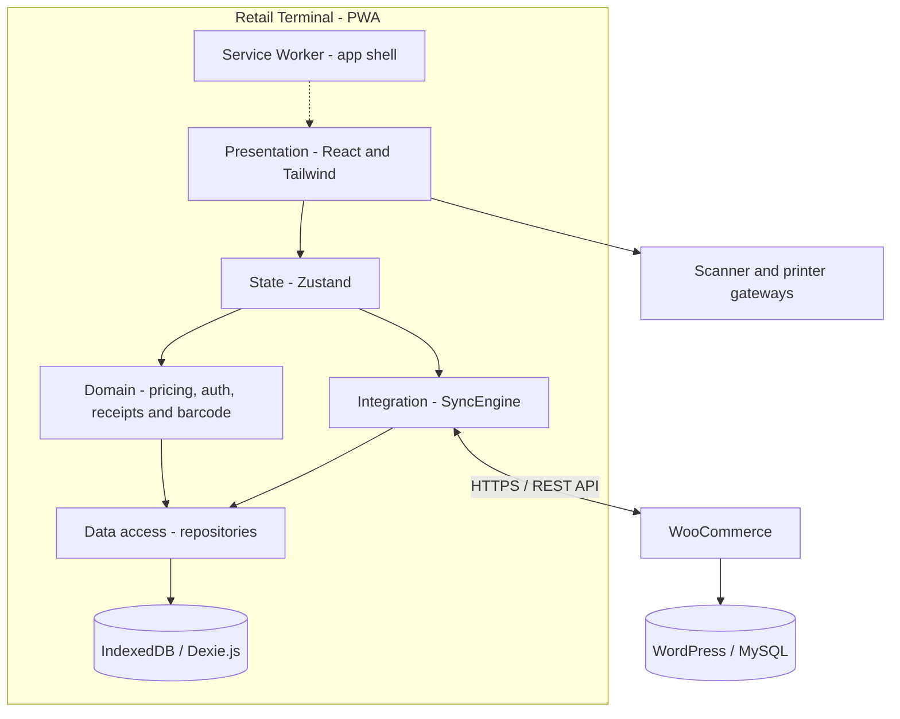
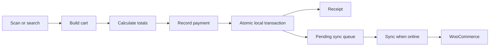
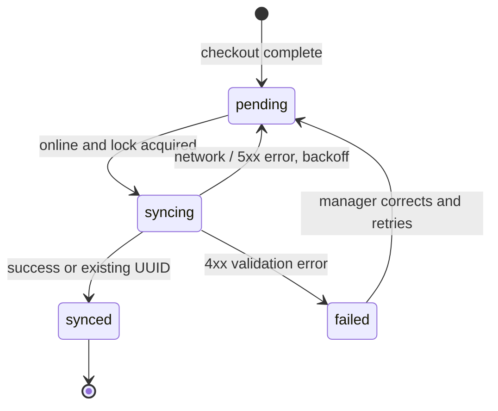

<div align="center">

# wPOS

### Commerce that keeps moving. Even when the internet doesn't.

**Offline-first point of sale for WooCommerce-powered retail.**


[Overview](#overview) · [Capabilities](#product-capabilities) · [Architecture](#system-architecture) · [Getting started](#getting-started) · [Team](#engineering-team)

</div>

---

## Overview

**wPOS** is an offline-first retail point-of-sale system designed for businesses that rely on WooCommerce but cannot afford to stop selling during network interruptions. The terminal maintains a local working catalog and records sales on the device. When connectivity returns, queued orders are synchronized with WooCommerce.

Unlike a server-dependent checkout, wPOS is designed to keep the critical sales workflow local: scanning, pricing, payment recording, receipt generation and order persistence.

> **Product principle:** Internet connectivity should enhance the retail experience, not determine whether a sale can take place.

**Development status:** This repository represents an academic engineering project under development. The capabilities and architecture below describe the intended product; they are not a claim of completed implementation, production readiness or verified performance.

## Product capabilities

| Module | Designed capabilities |
| :--- | :--- |
| **Sales terminal** | Barcode scanning, product search, category filters, cart editing and cart recovery |
| **Checkout** | Tax and discount calculations, cash and bank-transfer recording, split tender and change calculation |
| **Offline operations** | IndexedDB catalog, atomic sale persistence, local stock updates and queued orders |
| **Synchronization** | Initial catalog download, delta updates, UUID-based order reconciliation, retries and sync status |
| **Access management** | Terminal activation, cashier and manager roles, sessions and terminal deactivation |
| **Retail hardware** | HID barcode scanners, 80 mm ESC/POS receipts, EAN-13 and Code128 labels, batch printing |
| **Store management** | Sales summaries by date, terminal and cashier; hardware settings and terminal management |
| **Progressive Web App** | Installable application shell, offline startup, keyboard-friendly and touch-friendly interface |

### Product experience

| Cashier workspace | Manager workspace |
| :--- | :--- |
| Fast barcode-driven checkout | Sales dashboard and synchronization visibility |
| Searchable product catalog | Barcode label creation and batch printing |
| Persistent cart and payment dialog | Terminal and hardware configuration |
| Receipt preview and printing | Stock override and exception review |

The interface is intended to prioritize speed, readable pricing, clear payment feedback and visible connectivity status. Product screenshots will be added after the interface is implemented and verified.

## System architecture

The approved design uses five layers. IndexedDB is the terminal's working database; WooCommerce is the remote synchronization target. Checkout must not depend on a live network request.



### Offline checkout lifecycle



A completed sale is designed to persist the order, payment and synchronization entry, decrement local stock and clear the active cart in a single local transaction. Printing happens after persistence so a printer failure does not invalidate a recorded sale.

### Order synchronization states



Duplicate prevention requires server-side idempotency or reliable UUID lookup and reconciliation. It must be tested against ambiguous network failures, not assumed from UUID generation alone.

## Technology stack

| Layer | Technology | Responsibility |
| :--- | :--- | :--- |
| Presentation | React 18, Vite, Tailwind CSS | Terminal and management screens |
| State | Zustand | Cart, session, settings and sync state |
| Domain | JavaScript services | Pricing, payments, receipts, barcode and authentication logic |
| Local persistence | IndexedDB, Dexie.js | Catalog, sessions, sales, cart and queue |
| Integration | Axios, WooCommerce REST API v3 | Remote catalog and order synchronization |
| Offline shell | Service Worker / PWA | Cached application and offline startup |
| Hardware | HID, ESC/POS, WebUSB / Web Serial where supported | Scanning and printing |

## Data model

The planned local persistence model includes products, categories, variations, customers, terminals, cashiers, shifts, active carts, sale orders, order lines, payments, receipts, synchronization queue entries and synchronization attempts. Store configuration and hardware preferences are also persisted locally.

The sale order is identified by a client-generated UUID and associated with the terminal, cashier and shift for auditing.

## Repository structure

Proposed structure aligned with the project design. The final tree may evolve as implementation progresses.

```text
wPOS/
├── src/
│   ├── pages/             # Terminal, login, dashboard, barcode manager
│   ├── components/        # Reusable UI and checkout dialogs
│   ├── stores/            # Zustand state management
│   ├── domain/            # Pricing, authentication, receipts, barcode
│   ├── data/              # Dexie database and repositories
│   ├── integration/       # WooCommerce, sync and hardware gateways
│   └── service-worker/    # Offline application shell
├── public/                # Static assets and PWA manifest
├── tests/                 # Unit and integration tests
├── docs/                  # Design, setup and test evidence
├── .env.example           # Non-secret configuration template
├── .gitignore
├── package.json
└── README.md
```

## Getting started

### Prerequisites

- Git and a supported Node.js LTS release (use the version required by the project's package configuration).
- npm and a modern Chromium-based browser for the intended terminal experience.
- A test WooCommerce store with HTTPS and authorized integration access.
- Optional compatible barcode scanner and thermal or label printer.

### Local development

Once the repository is initialized and its package configuration is available, clone it using the URL from GitHub's **Code** menu, open the repository directory and run:

```bash
npm install
npm run dev
```

Open the local URL printed by Vite. For the intended production build workflow:

```bash
npm run build
npm run preview
```

These are proposed Vite commands; verify them against the actual `package.json` after scaffolding. They have not been executed against this repository.

### Configuration and database connection

1. Initialize the local Dexie database and its schema versions.
2. Configure the test WooCommerce store URL and a secure integration endpoint or server-side credential mechanism.
3. Activate the terminal and authenticate with authorized test accounts.
4. Download the initial catalog and verify IndexedDB records in browser developer tools.
5. Complete a test sale offline, reconnect and verify that the order is reconciled with WooCommerce exactly once.

> [!IMPORTANT]
> Do not place WooCommerce consumer secrets in browser JavaScript, `VITE_*` variables, committed files or screenshots. Vite client variables are public to the browser. A secure server-side integration boundary (or appropriately authorized WooCommerce extension) is recommended for privileged operations; its implementation must be reconciled with the approved architecture. Never commit real credentials or customer data.

## Quality and security targets

| Area | Design target |
| :--- | :--- |
| Offline checkout | Core checkout functions operate without connectivity |
| Integrity | Atomic sale writes and idempotent order synchronization |
| Performance | Scan-to-cart under 10 ms and receipt render under 15 ms on target hardware with a 10,000-product catalog |
| Sync efficiency | More than 90% reduction in transferred data after initial sync, subject to workload and measurement |
| Security | HTTPS, protected sessions, manager authorization and least-privilege credentials |
| Accessibility | Keyboard access and touch targets of at least 44 px for sale functions |
| Auditability | Terminal, cashier and shift associated with every order |

These are requirements from the design, not benchmark results or security certifications.

### Verification checklist

- [ ] Database initializes and survives application reload.
- [ ] Product search and barcode lookup work offline.
- [ ] Tax, discounts, split payments and change calculations pass tests.
- [ ] Checkout persists atomically, including local stock and queue entries.
- [ ] Reconnection sync handles duplicate attempts, network failures and validation failures.
- [ ] Authentication and manager permissions are tested.
- [ ] Receipt and barcode printing are tested on supported hardware.
- [ ] PWA starts offline after initial installation.
- [ ] Performance targets are measured on representative hardware.

## Engineering team

| Team member | Roll number | Ownership | Feature branch |
| :--- | :--- | :--- | :--- |
| Saif Ullah Awan | 230993 | UI/UX, frontend, hardware and PWA | `feature/frontend-ui` |
| Muhammad Bilal Ali | 232948 | Backend, authentication, WooCommerce and sync | `feature/backend-api` |
| Baseer Ud Din Mughal | 230975 | POS, pricing, cart, checkout and payments | `feature/pos-checkout` |
| Muhammad Anas Riaz | 231253 | Database, repositories and inventory | `feature/database` |

**Academic supervisor:** Sir Hafiz Obaid Ullah Khan  
**Institution:** Air University

## Development workflow


- `main`: stable submission branch.
- `develop`: shared integration branch.
- `feature/*`: individual module development.
- Every member pushes genuine individual contributions daily and links commits to actual Jira issue keys.
- Review changes before merging; never force-push shared branches without coordination.

Example commit (replace the sample Jira key with your assigned issue):

```bash
git add .
git commit -m "WPOS-14 feat: implement secure terminal authentication"
git push origin feature/backend-api
```

### Delivery roadmap

| Sprint | Planned focus |
| :--- | :--- |
| 01 | Repository, architecture, database and integration foundation |
| 02 | Terminal activation, authentication and catalog download |
| 03 | Cart, pricing, inventory and checkout |
| 04 | Atomic offline persistence and order synchronization |
| 05 | Dashboard, barcode labels, receipts and hardware |
| 06 | PWA, integration tests, performance verification and submission |

### Project tracking

Jira board URL: **To be added after board creation.**  
GitHub repository URL: **Use this repository's canonical URL.**

The supervisor must be invited to the private GitHub repository and Jira project with appropriate access before submission.

## Scope boundaries

The initial scope excludes cross-terminal refunds, multi-store inventory transfers and payment-card gateway integration. Cash and bank transfers are recorded by the POS; the application is not intended to process card payments or execute bank transfers.

## License and usage

Developed as an academic semester project. No open-source license has been selected. Distribution and reuse are subject to the repository owners' authorization and applicable third-party licenses.

---

<div align="center">

**wPOS — Local by design. Connected when available.**

Engineered for resilient retail operations · Air University

</div>
